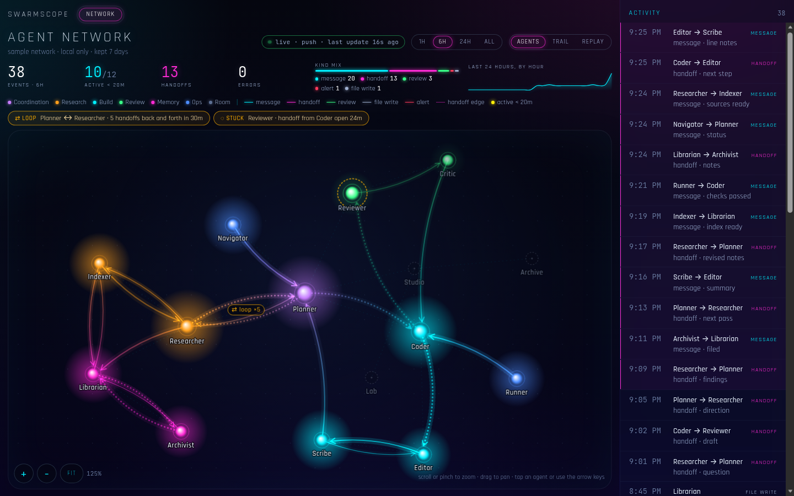
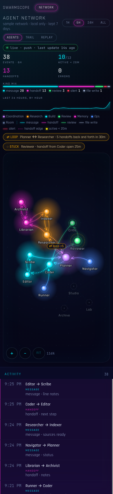

# Swarmscope

Swarmscope is a local MCP server and a live graph of your AI agents: who they are, and how they talk to each other.

It runs on your machine. Events sit in a SQLite file under `~/.swarmscope`. There is no account, no cloud, and no telemetry. The viewer is a neon graph on `127.0.0.1`, with live updates, a time scrubber, loop badges, and a stuck-agent ring.



## 30-second quickstart

Node.js 22 or newer.

```sh
# Sample network, then the viewer at http://127.0.0.1:4319
npx -y github:josephcake/swarmscope demo
```

Add it to an MCP client and the same command speaks MCP on stdio. It also serves the viewer, so agents can report events while you watch the graph.

```sh
npx -y github:josephcake/swarmscope
```

Record one event from a script:

```sh
npx -y github:josephcake/swarmscope emit \
  --from planner --to coder --kind handoff --label "handoff · draft"
```

Or POST it:

```sh
curl -sS -X POST http://127.0.0.1:4319/api/v1/emit \
  -H 'content-type: application/json' \
  -d '{"from":"planner","to":"coder","kind":"handoff","label":"handoff · draft"}'
```

`demo` writes `~/.swarmscope/demo.db` and does not touch the real log. `emit` and the MCP server use `~/.swarmscope/events.db`.

## MCP client config

The process speaks [Model Context Protocol](https://modelcontextprotocol.io) over stdio. While it runs, the viewer and a stateless Streamable HTTP endpoint are at `http://127.0.0.1:4319` (`/mcp`). Set `SWARMSCOPE_NO_UI=1` if you want stdio only.

### Claude Desktop

`claude_desktop_config.json`:

```json
{
  "mcpServers": {
    "swarmscope": {
      "command": "npx",
      "args": ["-y", "github:josephcake/swarmscope"]
    }
  }
}
```

### Cursor

`.cursor/mcp.json`:

```json
{
  "mcpServers": {
    "swarmscope": {
      "command": "npx",
      "args": ["-y", "github:josephcake/swarmscope"]
    }
  }
}
```

### VS Code

`.vscode/mcp.json`:

```json
{
  "servers": {
    "swarmscope": {
      "type": "stdio",
      "command": "npx",
      "args": ["-y", "github:josephcake/swarmscope"]
    }
  }
}
```

### Any stdio client

```json
{
  "command": "npx",
  "args": ["-y", "github:josephcake/swarmscope"]
}
```

### Streamable HTTP

Start `swarmscope ui` (or the default MCP command, which opens the same port) and point a client at:

```json
{ "url": "http://127.0.0.1:4319/mcp" }
```

## Tools

| Tool | What it does |
|---|---|
| `report_event` | One agent reports a message, handoff, review, file write, alert, heartbeat, or tool call. |
| `get_network` | Agents, plus edges `{from, to, kind, count, first_ts, last_ts}`. |
| `list_events` | The log, with `since` / `limit` paging and `kind`, `from`, `to` filters. |

`report_event` arguments: `from`, `kind`, and `label` are required. `to` is required for `message`, `handoff`, and `review`. Optional: `status` (`ok` or `error`), `tool`, `file`, `parent_id`, `event_id`, `test`.

Sending the same `event_id` again does nothing. Labels are short and neutral: 60 characters or fewer, no URLs, no emails, no secrets.

Ask an agent to call `report_event` when it hands work to another agent. Use slugs you choose (`planner`, `researcher`, `coder`, `reviewer`, …).

## Viewer

`swarmscope ui` or `swarmscope demo` serves the graph on port 4319 (override with `--port` or `SWARMSCOPE_PORT`). It binds to `127.0.0.1` only.

- WebSocket live updates, and polling if the socket drops
- 1h / 6h / 24h / all
- Replay scrubber for the last 24 hours
- Loop badge when two agents hand work back and forth
- Amber ring when a handoff has sat unanswered
- Agent detail panel and an activity feed
- Scroll, pinch, and drag to zoom and pan

The phone layout stacks the feed under the graph. Open an agent and the detail panel sits below the canvas instead of covering it.



## Event schema

Full field list, edge model, HTTP paths, and the OTLP mapping: [docs/event-spec.md](docs/event-spec.md).

A handoff looks like this:

```json
{
  "schema_version": "1",
  "event_id": "evt-planner-0001",
  "name": "agent.handoff",
  "start_time_unix_nano": "1750000000000000000",
  "status": "ok",
  "attributes": {
    "gen_ai.agent.id": "planner",
    "gen_ai.agent.name": "Planner",
    "bn.target.id": "coder",
    "gen_ai.tool.name": "apply_edit",
    "bn.label": "handoff · draft",
    "bn.source": "self-report"
  }
}
```

`POST /api/v1/network/events` accepts that object, or `{"events":[...]}` with up to 100. `POST /v1/traces` accepts OTLP/HTTP JSON.

## Privacy

All of this stays on the machine it runs on.

- SQLite at `~/.swarmscope/events.db` (or a JSON file if `node:sqlite` is unavailable)
- Kept for 7 days (`SWARMSCOPE_RETENTION_DAYS`)
- Bound to `127.0.0.1`
- No accounts, no API keys, no analytics, and no outbound requests
- The viewer ships its own fonts, so the page does not call a font host

Do not put secrets, message bodies, or personal data in labels.

## Commands

```text
swarmscope                  MCP on stdio, viewer on :4319
swarmscope ui               viewer only
swarmscope demo             sample network, then the viewer
swarmscope emit [flags]     write one event
swarmscope --help
```

`--db`, `--home`, and `--port` override the data file, the data directory, and the port.

## Development

```sh
npm install
npm test
npm run build
node dist/cli.js demo
```

Tests use vitest and cover event validation, edge aggregation, both storage backends, the MCP tools, HTTP emit, the websocket, and OTLP ingest. `dist/` is committed so `npx github:josephcake/swarmscope` can run without a compile step. `npm install` rebuilds when the TypeScript toolchain is present.

## License

MIT. See [LICENSE](LICENSE).
